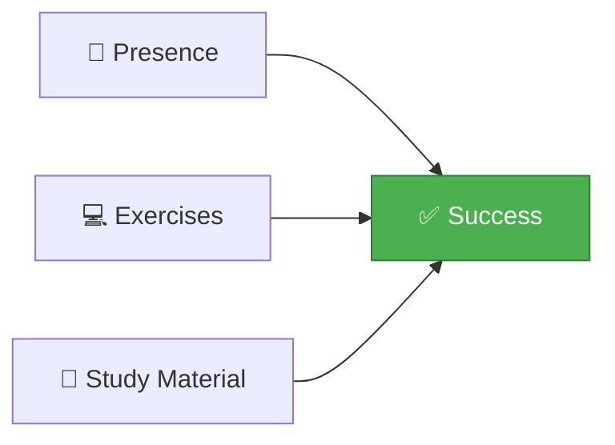

# 🎓 Course Introduction

## 👨‍🏫 Lecturers

<div style="background: linear-gradient(135deg, #667eea 0%, #764ba2 100%); padding: 20px; border-radius: 10px; color: white;">

**Milan Dima**  
📧 milan.dima@vives.be

</div>

---

## 📋 Ground Rules

### 📊 Grading

```
💯 100% Project + Oral Defense Exam
```

> 📌 **Important:** See Toledo for detailed information about practical organization

---

### ❓ Questions & Communication

<table>
<tr>
<td style="background-color: #e3f2fd; padding: 15px; border-radius: 5px;">

**📚 Course & Practical Questions**

- Use the **Forum on Toledo**
- Help each other learn!

</td>
<td style="background-color: #fff3e0; padding: 15px; border-radius: 5px;">

**🔒 Private Matters**

- Email or Teams
- Direct communication with lecturers

</td>
</tr>
</table>

---

### 💡 Best Preparation



> 🎯 **Key to Success:** Regular attendance + Active practice = Mastery!

---

## 🔄 Git Recap

<div style="background-color: #f5f5f5; padding: 20px; border-left: 4px solid #ff6b6b; border-radius: 5px;">

### Essential Git Commands

```bash
# Initialize a new repository
git init

# Connect to remote repository
git remote add origin [URL]

# Stage all changes
git add .

# Commit your changes
git commit -m 'eerste commit'

# Push to main branch
git push origin main
```

> ⚠️ **Note:** Some repositories still use `master` instead of `main`

</div>

---

## Working with Classroom 50

Every chapter ends with a lab. We use **Classroom 50** to hand out the labs and to grade them automatically. Labs give you feedback; they do not count towards your grade.

**Your group has its own classroom.** TI, ACS and AO each have a separate classroom with separate links. Always use the page of your own group in [Classroom 50 invites](../classroom50/README.md).

### Once

1. Accept the email invitation to the GitHub organization **VivesMDima**. Your teacher sends it at the start of the course.
2. Make sure Git and Node.js are installed (see [Installation & Setup](./04-installation-setup.md)).

### For every lab

1. Open your group's page in [Classroom 50 invites](../classroom50/README.md) and click the accept link of the lab. Classroom 50 creates your own private repository, for example `2627-node-ti-lab04-express-api-<your-username>`.
2. Clone it and install the packages:

   ```bash
   git clone <url of your repository>
   cd <repository>
   npm install
   ```

3. Read the `README.md`: it describes every requirement (R1, R2, ...).
4. Work and test locally. `npm test` runs the same checks as the autograder:

   ```bash
   npm test                                  # all requirements
   npm test -- --test-name-pattern="^R1:"    # one requirement
   ```

5. Commit your work and submit it:

   ```bash
   git add .
   git commit -m "Describe your change"
   npm run submit
   ```

6. After a few minutes your result appears on the **Releases** page of your repository: your score and a PASS/FAIL line per requirement with the reason for each failure. Your teacher can comment in the **Feedback** pull request.

You can submit as often as you like; the latest submission counts. An overview of all labs is in [Labs](../LABS.md).

---

## 🚀 Ready to Start?

Now that you know the basics, let's dive into **Node.js**!

> 💪 **Remember:** Practice makes perfect. Don't hesitate to ask questions on the forum!

---

<div style="text-align: center; padding: 20px; color: #666;">

[🏠 Course Home](../README.md) | [📘 Chapter 1 Home](./README.md) | [Next: What is Node.js →](./02-what-is-nodejs.md)

</div>
