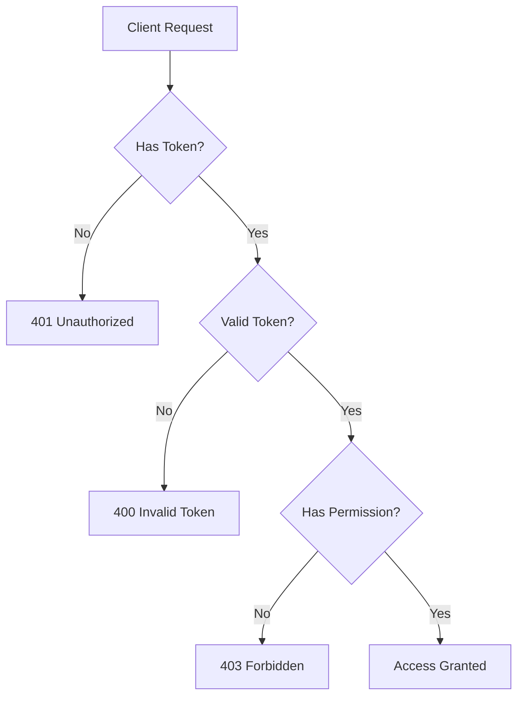

# Chapter 10: Authorization & Authentication

## Introduction

> **Authentication** vs **Authorization**
>
> **Authentication**: Making the identity of a subject known — e.g., by entering a password.
>
> **Authorization**: Granting a subject (person or process) rights to access an object (file, system).
>
> In short: **authentication** = logging in, identifying the user. **authorization** = accessing resources based on that identity.

---

<!-- lab:lab10-auth -->
## Lab 10: Authentication and Authorization

Add users, login with JSON Web Tokens, and protect the Vivesbib API with authentication and an admin role.

This lab continues where lab08-validation ended; the starter contains a working version of that lab.

- **Starter template:** [MilanVives/node-lab-10-auth](https://github.com/MilanVives/node-lab-10-auth)
- **Accept the lab:** use the link on **your own group's page** in [Classroom 50 invites](../classroom50/README.md)

| Requirement | Points |
|---|---|
| R1: POST /api/users registers a user | 2 |
| R2: POST /api/auth logs a user in | 2 |
| R3: The auth middleware protects changes to genres | 2 |
| R4: GET /api/users/me returns the current user | 2 |
| R5: Only admins can delete genres | 2 |

The README in your repository explains every requirement in detail.

**Work locally**

```bash
npm install
npm test                                     # all requirements
npm test -- --test-name-pattern="^R1:"       # one requirement
```

**Submit:** commit your work, then run `npm run submit`. You can submit as often as you like; the latest submission counts.

**Feedback:** after a few minutes the **Releases** page of your repository shows your score and a PASS/FAIL line per requirement with the reason for each failure. Your teacher can add comments in the **Feedback** pull request.
<!-- /lab -->

---

### Objective

- **Goal:** only logged-in users get rights to modify data → C(R)U(D)
- **Additional security:** only **admin users** can delete data → (CRU)D

| | CREATE | READ | UPDATE | DELETE |
|---|---|---|---|---|
| **Visitor** | ❌ | ✅ | ❌ | ❌ |
| **Logged-in** | ✅ | ✅ | ✅ | ❌ |
| **Admin** | ✅ | ✅ | ✅ | ✅ |

---

### Two New Endpoints

We need two new endpoints:

- **Register:** `POST /api/users` → `{ name, email, password }` (email must be unique)
- **Login:** `POST /api/auth` → `{ email, password }` → returns a JWT

---

### Authentication Steps (overview)

1. Create a **User model**
2. Create a **user endpoint/route** for registration
3. Create an **auth endpoint/route** for login
4. **Hash passwords** with bcrypt
5. Return a **JSON Web Token** on login
6. Save the **PrivateKey** in an environment variable
7. Send the **JWT in headers** with each request

---

### Topics Covered

- User model + registration route
- Password hashing with bcrypt
- Login route + JWT generation
- Environment variables with the `config` package
- Information Expert Principle — `generateAuthToken` on the User model
- Auth middleware (`middleware/auth.js`)
- Protecting routes
- Getting the current user (`/me`)
- User logout
- Role-based authorization (`isAdmin`)
- Admin middleware (`middleware/admin.js`)

---

### Key Concepts



---

[🏠 Home](../README.md) | [Next: User Model & Registration →](02-user-model.md)
