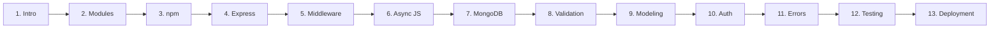

# Node.js Course

**Full-Stack JavaScript Development with Node.js**
VIVES University of Applied Sciences — Milan Dima

This course takes you from the Node.js basics to building complete back-end applications with Express, MongoDB, authentication, testing and deployment.

---

## Target Groups

This course is shared by three programmes:

| Group | Programme |
|-------|-----------|
| **TI** | Toegepaste Informatica |
| **ACS** | Applied Computer Science (international Erasmus students) |
| **AO** | Afstandsonderwijs (distance learning) |

The course material is the same for all groups. Schedules, deadlines and any group-specific arrangements are published on **Toledo**.

---

## Chapters

### [1. Introduction and Installation](./01-Intro/README.md)

What Node.js is, its architecture, installation and a first application.

- [01 - Course Introduction](./01-Intro/01-course-introduction.md)
- [02 - What is Node.js](./01-Intro/02-what-is-nodejs.md)
- [03 - Node.js Architecture](./01-Intro/03-nodejs-architecture.md)
- [04 - Installation & Setup](./01-Intro/04-installation-setup.md)
- [05 - First Application](./01-Intro/05-first-application.md)

### [2. Node Module System](./02-Node-Module-System/README.md)

Global objects, modules, built-in modules, events and the HTTP module.

- [01 - Global Objects](./02-Node-Module-System/01-global-objects.md)
- [02 - Module System Basics](./02-Node-Module-System/02-module-system.md)
- [03 - Creating Custom Modules](./02-Node-Module-System/03-creating-modules.md)
- [04 - Built-in Modules](./02-Node-Module-System/04-builtin-modules.md)
- [05 - Events & EventEmitter](./02-Node-Module-System/05-events.md)
- [06 - HTTP Module](./02-Node-Module-System/06-http-module.md)

### [3. Node Package Manager (npm)](./03-Node-NPM/README.md)

`package.json`, installing packages, semantic versioning, dependencies and publishing.

- [01 - What is npm?](./03-Node-NPM/01-what-is-npm.md)
- [02 - package.json](./03-Node-NPM/02-package-json.md)
- [03 - Installing Packages](./03-Node-NPM/03-installing-packages.md)
- [04 - Semantic Versioning](./03-Node-NPM/04-semantic-versioning.md)
- [05 - Managing Dependencies](./03-Node-NPM/05-managing-dependencies.md)
- [06 - Publishing Packages](./03-Node-NPM/06-publishing-packages.md)

### [4. Building APIs with Express](./04-Express-API/README.md)

REST principles, Express routing, CRUD requests, route parameters and tooling (Postman, nodemon).

- [01 - REST & Express](./04-Express-API/01-rest-and-express.md)
- [02 - GET Requests](./04-Express-API/02-get-requests.md)
- [03 - POST Requests](./04-Express-API/03-post-requests.md)
- [04 - PUT & DELETE Requests](./04-Express-API/04-put-delete-requests.md)
- [05 - Tools & Best Practices](./04-Express-API/05-tools-best-practices.md)

### [5. Middleware](./05-Middleware/README.md)

The middleware pipeline, built-in and third-party middleware, environments, configuration and project structure.

- [01 - Middleware Basics](./05-Middleware/01-middleware-basics.md)
- [02 - Built-in Middleware](./05-Middleware/02-builtin-middleware.md)
- [03 - Third-party Middleware](./05-Middleware/03-third-party-middleware.md)
- [04 - Environments & Config](./05-Middleware/04-environments-config.md)
- [05 - Templating & Structure](./05-Middleware/05-templating-structure.md)

### [6. Asynchronous JavaScript](./06-Async-JS/README.md)

Synchronous vs asynchronous code, callbacks, promises and async/await.

- [01 - Sync vs Async](./06-Async-JS/01-sync-vs-async.md)
- [02 - Callbacks](./06-Async-JS/02-callbacks.md)
- [03 - Promises](./06-Async-JS/03-promises.md)
- [04 - Async/Await](./06-Async-JS/04-async-await.md)

### [7. MongoDB & Mongoose](./07-MongoDB/README.md)

Connecting to MongoDB, schemas and models, CRUD operations, querying, pagination and sorting.

- [01 - MongoDB Setup](./07-MongoDB/01-mongodb-setup.md)
- [02 - Schemas & Models](./07-MongoDB/02-schemas-models.md)
- [03 - Creating Documents](./07-MongoDB/03-creating-documents.md)
- [04 - Reading Documents](./07-MongoDB/04-reading-documents.md)
- [05 - Updating Documents](./07-MongoDB/05-updating-documents.md)
- [06 - Deleting Documents](./07-MongoDB/06-deleting-documents.md)

### [8. Data Validation](./08-Data-Validation/01-introduction.md)

Mongoose validation, built-in and custom validators, and adding persistence to the Express API.

- [01 - Introduction](./08-Data-Validation/01-introduction.md)
- [02 - Validation in Mongoose](./08-Data-Validation/02-validation-mongoose.md)
- [03 - Custom Validators](./08-Data-Validation/03-custom-validators.md)
- [04 - Adding Persistence](./08-Data-Validation/04-adding-persistence.md)
- [05 - Refactoring GET](./08-Data-Validation/05-refactoring-get.md)
- [06 - Refactoring POST](./08-Data-Validation/06-refactoring-post.md)
- [07 - Refactoring PUT](./08-Data-Validation/07-refactoring-put.md)
- [08 - Refactoring DELETE](./08-Data-Validation/08-refactoring-delete.md)
- [09 - Testing](./08-Data-Validation/09-testing.md)
- [10 - Lab Assignment](./08-Data-Validation/10-lab.md)

### [9. Mongoose Modeling](./09-Mongoose-Modeling/01-intro.md)

Referencing vs embedding, hybrid approaches, subdocuments and transactions.

- [01 - Introduction to Modeling](./09-Mongoose-Modeling/01-intro.md)
- [02 - Referencing vs Embedding](./09-Mongoose-Modeling/02-referencing-embedding.md)
- [03 - Hybrid Approach](./09-Mongoose-Modeling/03-hybrid-approach.md)
- [04 - Referencing Documents](./09-Mongoose-Modeling/04-referencing-documents.md)
- [05 - Embedding Documents](./09-Mongoose-Modeling/05-embedding-documents.md)
- [06 - Arrays of Subdocuments](./09-Mongoose-Modeling/06-arrays-subdocuments.md)
- [07 - MongoDB ObjectIDs](./09-Mongoose-Modeling/07-objectids.md)
- [08 - Transactions](./09-Mongoose-Modeling/08-transactions.md)
- [09 - Recap](./09-Mongoose-Modeling/09-recap.md)
- [10 - Lab: Movie Review Database](./09-Mongoose-Modeling/10-lab.md)
- [11 - Classroom Assignment](./09-Mongoose-Modeling/11-classroom-lab.md)

### [10. Authentication & Authorization](./10-Auth-And-Auth/01-intro.md)

JWT authentication, auth middleware, role-based authorization and logout.

- [01 - Introduction](./10-Auth-And-Auth/01-intro.md)
- [02 - User Model & Registration](./10-Auth-And-Auth/02-user-model.md)
- [03 - Login Route & JWT](./10-Auth-And-Auth/03-login-and-jwt.md)
- [04 - Auth Middleware](./10-Auth-And-Auth/04-auth-middleware.md)
- [05 - Protecting Routes](./10-Auth-And-Auth/05-protecting-routes.md)
- [06 - Getting Current User](./10-Auth-And-Auth/06-current-user.md)
- [07 - User Logout](./10-Auth-And-Auth/07-user-logout.md)
- [08 - Role-Based Authorization](./10-Auth-And-Auth/08-role-based-auth.md)
- [09 - Admin Middleware](./10-Auth-And-Auth/09-admin-middleware.md)
- [10 - Applying Admin Middleware](./10-Auth-And-Auth/10-applying-admin.md)
- [11 - Summary](./10-Auth-And-Auth/11-summary.md)

### [11. Error Handling](./11-Error-Handling/01-introduction.md)

Synchronous and asynchronous errors, custom error classes and Express error middleware.

- [01 - Introduction](./11-Error-Handling/01-introduction.md)
- [02 - Synchronous Error Handling](./11-Error-Handling/02-synchronous-errors.md)
- [03 - Asynchronous Error Handling](./11-Error-Handling/03-async-errors.md)
- [04 - Express Error Middleware](./11-Error-Handling/04-express-errors.md)
- [05 - Best Practices](./11-Error-Handling/05-best-practices.md)

### [12. Testing](./12-Testing/01-introduction.md)

The built-in Node.js test runner, unit and integration tests, assertions, mocking and code coverage.

- [01 - Introduction to Testing](./12-Testing/01-introduction.md)
- [02 - Writing Your First Test](./12-Testing/02-first-test.md)
- [03 - Assertions](./12-Testing/03-assertions.md)
- [04 - Async Testing](./12-Testing/04-async-testing.md)
- [05 - Mocking and Spies](./12-Testing/05-mocking.md)
- [06 - Code Coverage](./12-Testing/06-coverage.md)
- [07 - Best Practices](./12-Testing/07-best-practices.md)
- [08 - Lab Exercise](./12-Testing/08-lab.md)

### [13. Deployment](./13-Deployment/01-introduction.md)

Preparing for production, Linux VMs with PM2 and Nginx, PaaS options (Render, Railway, Fly.io, Koyeb, Vercel) and Supabase.

- [01 - Introduction](./13-Deployment/01-introduction.md)
- [02 - Preparing for Production](./13-Deployment/02-production-prep.md)
- [03 - Linux VM](./13-Deployment/03-linux-vm.md)
- [04 - PM2 & Nginx](./13-Deployment/04-pm2-nginx.md)
- [05 - Render & Railway](./13-Deployment/05-render-railway.md)
- [06 - Supabase](./13-Deployment/06-supabase.md)
- [07 - Other Options](./13-Deployment/07-other-options.md)
- [08 - Lab Exercise](./13-Deployment/08-lab.md)

---

## How to Use This Course

Work through the chapters in order — each one builds on the previous:

- Complete the lab exercises at the end of the chapters.
- Run the code examples yourself rather than only reading them.
- Ask course-related questions on the Toledo forum.

---

## Prerequisites

- JavaScript (ES6+)
- HTML & CSS
- Working with the command line
- Git & GitHub basics

---

## Setup

| Tool | Version | Link |
|------|---------|------|
| Node.js | Current LTS (v22 or later) | [nodejs.org](https://nodejs.org/) |
| npm | Included with Node.js | |
| VS Code | Latest | [code.visualstudio.com](https://code.visualstudio.com/) |
| Git | Latest | [git-scm.com](https://git-scm.com/) |
| MongoDB | v7 or later (local or Atlas) | [mongodb.com](https://www.mongodb.com/) |

Recommended VS Code extensions: ESLint, Prettier, REST Client, MongoDB for VS Code, and Markdown Preview Mermaid Support (to render the diagrams in the slides).

---

## Evaluation

100% project + oral defense. See **Toledo** for the detailed grading criteria and project requirements.

---

## Getting Help

1. Review the chapter material.
2. Search the Toledo forum — your question may already be answered.
3. Post on the forum for course or practical questions. Include your code, the error message and what you already tried.
4. Email the instructor for private matters only.

---

## Resources

- [Node.js documentation](https://nodejs.org/docs/)
- [Express documentation](https://expressjs.com/)
- [MongoDB documentation](https://www.mongodb.com/docs/)
- [Mongoose documentation](https://mongoosejs.com/docs/)
- [MDN Web Docs](https://developer.mozilla.org/)

---

**Node.js Course** — Academic Year 2026-2027
VIVES University of Applied Sciences — Milan Dima (milan.dima@vives.be)
